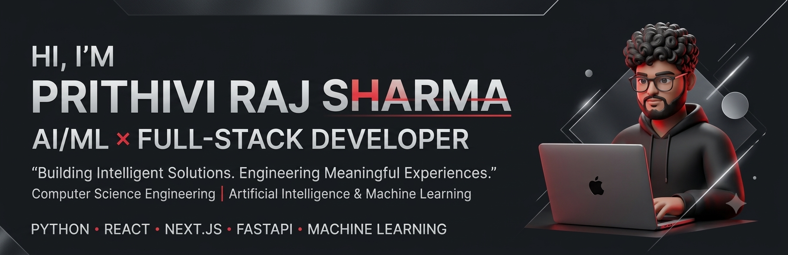

# Hi, I'm Prithivi Raj Sharma 👋

### Full Stack Developer | AI/ML Enthusiast

Building practical applications with modern web technologies and AI.

---

## 👨‍💻 About Me

- 🎓 B.Tech Computer Science student specializing in AI & Machine Learning.
- 💻 Interested in Full Stack Development and Artificial Intelligence.
- 🚀 Building practical applications and exploring new technologies.
- 🧠 Currently improving my problem-solving and development skills.
- 🏆 Participated in Smart India Hackathon 2026.

## 🔭 Featured Projects

### 🚀 SPACE EXPERIMENT ASTRA
An AI-powered mission assistance platform designed to support astronauts during space experiments.

- Mission control dashboard
- Activity recognition
- AI-powered voice assistant
- Backend APIs and experiment guidance

**Tech:** Next.js, React, TypeScript, Python, FastAPI.

### 🏢 BABITA COMPLEX
A property management application designed to manage rental shops, tenant payments, billing and electricity records.

**Tech:** Next.js, TypeScript, Prisma, SQLite.

*Private project.*

## 🛠️ Tech Stack

**Languages**

**Frontend**

**Backend & Database**

**Tools**

## 🏆 Achievements

- Smart India Hackathon 2026 — Runner-up.

## 📊 GitHub Statistics

---

### 💬 Let's Connect and Build Something Great!

**Thanks for visiting my profile!**

